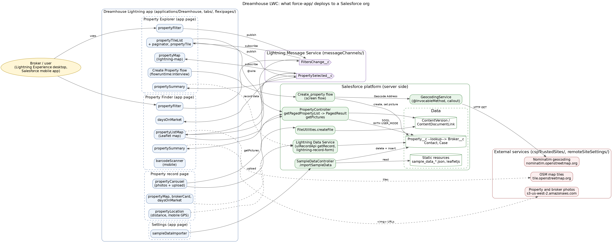

# Dreamhouse LWC architecture

Dreamhouse is a Salesforce DX project. Everything it ships is Salesforce metadata under [`force-app/main/default`](../force-app/main/default), deployed to an org with `sf project deploy start` or installed as the `DreamhouseLWC` unlocked package ([`sfdx-project.json`](../sfdx-project.json)). There is no separate server: the UI is Lightning Web Components running in Lightning Experience or the Salesforce mobile app, and the back end is Apex, a Flow, and the platform's own data layer.

Diagram source: [`diagrams/architecture.dot`](diagrams/architecture.dot) (Graphviz). Re-render the PNG and [SVG](diagrams/architecture.svg) with [`diagrams/render.sh`](diagrams/render.sh) after editing it (needs `graphviz` and `fonts-dejavu`).

## The app and its pages

The **Dreamhouse** Lightning app ([`applications/Dreamhouse.app-meta.xml`](../force-app/main/default/applications/Dreamhouse.app-meta.xml)) is available on desktop and phone and has these tabs: Home, Property Explorer, Property Finder, Contacts, Properties, Brokers, Files and Settings. The pages are Lightning pages in [`flexipages/`](../force-app/main/default/flexipages):

| Page                 | Type        | Components                                                                                                                                   |
| -------------------- | ----------- | -------------------------------------------------------------------------------------------------------------------------------------------- |
| Property Explorer    | App page    | `propertyFilter`, `propertyTileList` (uses `paginator`, `propertyTile`), `propertyMap`, `propertySummary`, the `Create_property` screen flow |
| Property Finder      | App page    | `propertyFilter`, `propertyListMap`, `propertySummary`, `daysOnMarket`, `barcodeScanner`                                                     |
| Property record page | Record page | `propertyCarousel`, `propertyLocation`, `propertyMap`, `brokerCard`, `daysOnMarket`, standard record detail and related lists                |
| Broker record page   | Record page | Standard highlights panel, record detail and related lists only                                                                              |
| Settings             | App page    | `sampleDataImporter`                                                                                                                         |

`listContactsFromDevice` is deployed but is not placed on any page. `errorPanel` and `ldsUtils` are shared helpers used by the other components to show errors. The Aura component `pageTemplate_2_7_3` is the custom three-column template used by the app pages.

In-App Guidance prompts in [`prompts/`](../force-app/main/default/prompts) walk users through the Property, Property Explorer and Property Finder pages.

## How components talk to each other

Components on the same page do not reference each other. They use two Lightning Message Service channels in [`messageChannels/`](../force-app/main/default/messageChannels):

- **`FiltersChange__c`**: `propertyFilter` publishes the search key, max price, min bedrooms and min bathrooms, debounced so typing does not fire one Apex call per keystroke. `propertyTileList` and `propertyListMap` subscribe and re-query.
- **`PropertySelected__c`**: `propertyTileList` and `propertyListMap` publish the selected property ID. `propertySummary`, `propertyMap` and `daysOnMarket` subscribe and load that record. On a record page these components use the page's `recordId` instead.

## Server side

| Piece                                                                                   | What it does                                                                                                                                                                                                                                                                                                                                                                                        | Called by                                                                                              |
| --------------------------------------------------------------------------------------- | --------------------------------------------------------------------------------------------------------------------------------------------------------------------------------------------------------------------------------------------------------------------------------------------------------------------------------------------------------------------------------------------------- | ------------------------------------------------------------------------------------------------------ |
| [`PropertyController`](../force-app/main/default/classes/PropertyController.cls)        | `getPagedPropertyList` filters `Property__c` by name, city or tags (`LIKE`), price, beds and baths, ordered by price, paged with `LIMIT`/`OFFSET` (9 per page by default) and returned as a [`PagedResult`](../force-app/main/default/classes/PagedResult.cls). `getPictures` returns the latest PNG/JPG/GIF `ContentVersion`s linked to a property. Both are cacheable and query `WITH USER_MODE`. | `propertyTileList`, `propertyListMap` (via `@wire`); `propertyCarousel`                                |
| [`FileUtilities`](../force-app/main/default/classes/FileUtilities.cls)                  | `createFile` inserts a `ContentVersion` from base64 data and links it to the record with a `ContentDocumentLink`.                                                                                                                                                                                                                                                                                   | `propertyCarousel` photo upload (images are resized client-side with `lightning/mediaUtils` first)     |
| [`SampleDataController`](../force-app/main/default/classes/SampleDataController.cls)    | `importSampleData` deletes every `Case`, `Property__c`, `Broker__c` and `Contact` in the org, then inserts brokers, properties and contacts from the `sample_data_*` static resources and gives each property a random `Date_Listed__c` within the last 90 days.                                                                                                                                    | `sampleDataImporter` on the Settings tab                                                               |
| [`GeocodingService`](../force-app/main/default/classes/GeocodingService.cls)            | `@InvocableMethod` "Geocode address": calls the OpenStreetMap Nominatim search API for each address and returns latitude and longitude (null when the address is blank or the call fails).                                                                                                                                                                                                          | The `Create_property` flow                                                                             |
| [`Create_property` flow](../force-app/main/default/flows/Create_property.flow-meta.xml) | Screen flow: collects the property and address, geocodes it, creates the `Property__c`, and if a picture was uploaded sets it as the property's main picture and thumbnail. Ends on `navigateToRecord`, which opens the new record.                                                                                                                                                                 | Property Explorer page                                                                                 |
| Lightning Data Service                                                                  | `getRecord` and `lightning-record-form` read and edit single records without Apex.                                                                                                                                                                                                                                                                                                                  | `propertySummary`, `propertyMap`, `daysOnMarket`, `brokerCard`, `propertyCarousel`, `propertyLocation` |

Apex tests live beside the classes (`FileUtilitiesTest`, `GeocodingServiceTest`, `TestPropertyController`, `TestSampleDataController`) and run in an org. LWC Jest tests live in each component's `__tests__` folder and run locally; platform modules are mocked in [`force-app/test/jest-mocks`](../force-app/test/jest-mocks).

## Data model

- **`Property__c`**: address, city, state, zip, price, beds, baths, description, tags, status (Contracted, Pre Market, Available, Under Agreement, Closed) with a date field per status, a geolocation field `Location__c`, picture and thumbnail URLs, and a lookup to `Broker__c`. `Date_Listed__c` defaults to `TODAY() - 10`, and the formula field `Days_On_Market__c` is `TODAY() - Date_Listed__c`.
- **`Broker__c`**: name, title, phone, mobile phone, email and picture.
- Standard `Contact` (sample data only), and `ContentVersion` / `ContentDocumentLink` for property photos.

The **`dreamhouse`** permission set grants access to both custom objects, their tabs, and the `PropertyController`, `PagedResult` and `SampleDataController` classes.

Sample data comes in two copies: [`data/`](../data) (loaded by `sf data tree import -p data/sample-data-plan.json`) and the `sample_data_brokers`, `sample_data_properties` and `sample_data_contacts` static resources (loaded by the Settings tab importer).

## External services

| Service                                                  | Used by                                                                     | Allowed by                                    |
| -------------------------------------------------------- | --------------------------------------------------------------------------- | --------------------------------------------- |
| Nominatim geocoding, `nominatim.openstreetmap.org`       | `GeocodingService` (Apex callout)                                           | Remote site setting `nominatim_openstreetmap` |
| OpenStreetMap tiles, `tile.openstreetmap.org`            | `propertyListMap`, which loads Leaflet from the `leafletjs` static resource | CSP trusted site `openStreetMap`              |
| Property and broker photos, `s3-us-west-2.amazonaws.com` | Picture URLs in the sample data, shown by tiles, cards and the summary      | CSP trusted site `s3_us_west_2_amazonaws_com` |

`propertyMap` uses the `lightning-map` base component, which needs no extra setup. `barcodeScanner` and `propertyLocation` use `lightning/mobileCapabilities` and only do anything in the Salesforce mobile app: the scanner reads a QR code holding a property ID and opens that record, and the location component shows the distance from the device to the property (`propertyLocation` falls back to the browser's geolocation on desktop).

## Build, test and release

- **Local checks** ([`package.json`](../package.json)): `npm run prettier:verify`, `npm run lint` (ESLint flat config in [`eslint.config.js`](../eslint.config.js)) and `npm run test:unit` (`sfdx-lwc-jest`). Volta pins Node 22.15.0.
- **Pre-commit**: Husky runs lint-staged, which formats staged files with Prettier, lints staged LWC JavaScript with ESLint and runs the Jest tests related to changed LWC files.
- **CI** ([`.github/workflows`](../.github/workflows)): `ci-pr.yml` (pull requests) and `ci.yml` (pushes to `main`) run Prettier, ESLint and LWC tests with coverage, then deploy to a scratch org and run the Apex tests. When a push to `main` changes `force-app`, `ci.yml` sends a `start-packaging` event and `packaging.yml` creates a new `DreamhouseLWC` package version, installs it in a scratch org and opens a PR that updates the install link in the README. The jobs run on the `trailheadapps-Ubuntu` runner and need the `DEVHUB_SFDX_URL` secret.
- **Code tour**: [`.tours/welcome-to-dreamhouse.tour`](../.tours/welcome-to-dreamhouse.tour) walks through the Property Explorer code in VS Code with the CodeTour extension.
